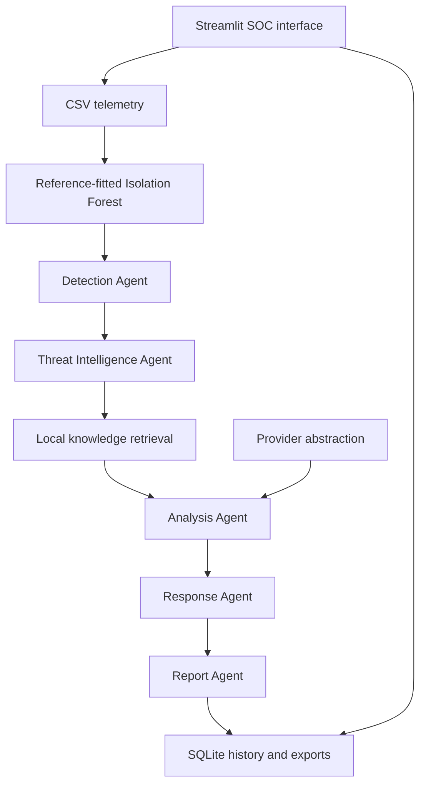

# CyberSentinel AI
### Agentic RAG-Based SOC Incident Detection and Response Assistant

A runnable Python security operations application combining Isolation Forest, local knowledge retrieval, modular agents, pluggable language models, and evidence-based incident reports.

**Start with no API keys.** The default local analysis engine creates structured explanations and response playbooks deterministically. It is not a local generative LLM. Select Ollama to use a local generative model, or OpenAI/Gemini for hosted analysis. The interface identifies the actual engine and any fallback.


## What is included

- Five SOC pages: Dashboard, Incident Investigation, Analytics, Reports, Knowledge Search.
- CSV upload and independently fitted trusted reference baselines.
- Isolation Forest prediction, anomaly score, decision function, and heuristic confidence.
- Five modular agents with execution traces and explicit input/output contracts.
- Sentence Transformer embeddings, FAISS top-K similarity retrieval, automatic first-run index construction, and knowledge refresh.
- Fully offline lexical retrieval fallback when model weights or optional dependencies are unavailable.
- OpenAI, Gemini, Ollama, and deterministic local analysis behind one provider abstraction.
- Structured threat hypotheses, candidate MITRE mappings, severity, risk, uncertainties, and source citations.
- Human-reviewed response playbooks, recovery steps, SOC checklists, and investigation next steps.
- SQLite incident history, audited status updates, revision conflict protection, and duplicate prevention.
- Markdown, JSON, and paginated PDF exports from a shared incident contract.
- Grounded SOC chat, knowledge search, similar incident retrieval, interactive Plotly analytics.
- 1,000 synthetic security windows, an independent 800-window normal reference, and 32 authored knowledge documents.
- Tests, container configuration, optional OIDC sign-in, and deployment documentation.

## Quick start

Python **3.11 or 3.12** is recommended. Create a virtual environment in the extracted `CyberSentinel_AI` directory.

```bash
python -m venv .venv
# macOS / Linux
source .venv/bin/activate
# Windows PowerShell
# .venv\Scripts\Activate.ps1
python -m pip install --upgrade pip
python -m pip install -r requirements.txt
cp .env.example .env
python run.py
```

On Windows, use `Copy-Item .env.example .env` instead of `cp`.
Open **http://127.0.0.1:8501**. The bundled demo is scored automatically. Select an alert and press **Run agent investigation**, then open **Incident Investigation** to review evidence, the response playbook, and downloads.

Installation requires internet access. After installation, local mode and lexical retrieval run without internet. Semantic mode also runs offline once embedding weights have been cached.

### Lightweight installation

Avoid installing PyTorch and Sentence Transformers when trying the offline workflow:

```bash
python -m pip install -r requirements-core.txt
python run.py
```

The same application runs using lexical hashing embeddings and FAISS. It displays `hashing / faiss` so you can distinguish this from semantic retrieval. If FAISS itself is unavailable on an unsupported platform, a tested NumPy similarity fallback remains usable; install the other core dependencies individually to use that route.

### Enable semantic retrieval

The default `EMBEDDING_BACKEND=auto` uses a cached Sentence Transformer and otherwise falls back without downloading weights. To download the semantic model on a machine with network access, set these values in `.env`:

```dotenv
EMBEDDING_BACKEND=sentence_transformer
ALLOW_MODEL_DOWNLOAD=true
EMBEDDING_MODEL=sentence-transformers/all-MiniLM-L6-v2
```

Run the app once. After the model is cached, set `ALLOW_MODEL_DOWNLOAD=false` for offline operation. Explicit `sentence_transformer` mode fails with a useful error if the model cannot load, rather than silently substituting lexical retrieval. Model weights are not bundled in this ZIP.

Optional CPU-only PyTorch installation on supported systems:

```bash
python -m pip install torch --index-url https://download.pytorch.org/whl/cpu
python -m pip install -r requirements.txt
```

## Run commands

```bash
python run.py                                # dashboard, localhost only
python run.py --port 8502                    # alternative port
python run.py --demo                         # headless local workflow and three exports
python -m ml.trainer                         # independent reference training + synthetic evaluation
python scripts/generate_data.py             # reproduce both CSV files
python -m pip install -r requirements-dev.txt
python -m pytest -q
python -m ruff check .
```

`python run.py --demo` writes Markdown, JSON, and PDF under `state/demo_exports`. An example incident in all three formats is already included in `docs/sample_reports`.

## LLM providers

Choose a provider from the sidebar or set `LLM_PROVIDER` in `.env`. Provider model names are configurable and can be changed without modifying agents.

| Provider | Required configuration | Behavior |
|---|---|---|
| local | None | Grounded rule-based explanations and retrieved chat excerpts; no generative model |
| openai | OPENAI_API_KEY, OPENAI_MODEL | Chat Completions with JSON output validated by Pydantic |
| gemini | GEMINI_API_KEY, GEMINI_MODEL | generateContent with JSON MIME type and server-side validation |
| ollama | OLLAMA_URL, OLLAMA_MODEL | Local `/api/chat`, non-streaming JSON analysis |

OpenAI example:

```dotenv
LLM_PROVIDER=openai
OPENAI_API_KEY=your-own-key
OPENAI_MODEL=gpt-4o-mini
ALLOW_CLOUD_LOGS=true
```

Gemini example:

```dotenv
LLM_PROVIDER=gemini
GEMINI_API_KEY=your-own-key
GEMINI_MODEL=gemini-2.5-flash
ALLOW_CLOUD_LOGS=true
```

The configured model must be available to your account; defaults are configuration choices rather than guarantees of availability. Cloud transmission requires the sidebar opt-in or `ALLOW_CLOUD_LOGS=true`. Only selected numerical fields and redacted message text are sent for cloud analysis; synthetic labels and identifiers are excluded. Retrieved context and chat history are also redacted. Redaction is best effort, so review data handling before enabling a hosted provider. Keys are never added to reports.

Ollama example:

```bash
ollama pull llama3.2:3b
ollama serve
```

```dotenv
LLM_PROVIDER=ollama
OLLAMA_URL=http://127.0.0.1:11434
OLLAMA_MODEL=llama3.2:3b
```

Hosted providers have bounded retries and timeouts. Invalid JSON, unsupported citations, unsupported MITRE mappings, refusals, and network errors trigger an explicitly reported local fallback by default. Set `ALLOW_LOCAL_FALLBACK=false` to require the selected provider to succeed. Live hosted requests require your credentials and were not made during verification; transport contracts were tested with mocks. A real cached Sentence Transformer and FAISS were exercised end to end.

## Architecture



| Module | Responsibility |
|---|---|
| Detection Agent | Reject unscored/non-anomalous events, validate evidence, create candidate hypothesis |
| Threat Intelligence Agent | Retrieve top-K local chunks and retain source IDs and similarity scores |
| Analysis Agent | Call the configured provider, validate structured output and source grounding, or run local analysis |
| Response Agent | Create phased recommendations, SOC checklist, next steps, and recovery plan |
| Report Agent | Assemble incident identity, evidence, provenance, and report fields |
| SOCWorkflow | Bound execution to five explicit stages, trace timing, and persist completed reports |

This is a bounded agent workflow. Agents do not execute shell commands, isolate endpoints, block addresses, or change accounts. Response actions remain reviewable recommendations. OIDC authentication can gate access, but organizational role enforcement and tenant isolation require deployment-specific extensions.

## Machine learning and confidence

Only these eight numeric fields enter the model:

`failed_attempts`, `login_frequency`, `bytes_sent`, `bytes_received`, `request_rate`, `unique_ports`, `authentication_failures`, `destination_count`.

They are transformed with `log1p`; Isolation Forest uses 200 trees, seed 42, and a reference sample cap of 1,024 windows. The default contamination is 0.08, determining the reference decision threshold. Uploaded target logs are scored against an existing model and never used to refit it automatically. Demo reference and evaluation data use independent random seeds.

- `prediction = -1`: statistically unusual; `+1`: inlier.
- `anomaly_score = -score_samples`: larger means more unusual.
- Negative `decision_function`: below the model's normality threshold.
- ML `confidence`: normalized distance of a reference percentile from the decision boundary, in [0.5, 1]. It is **not** a probability of an attack.
- Analysis confidence and risk score are separate, **uncalibrated heuristics** for prioritization.

Eight aggregate features cannot identify every attack, prove compromise, or reconstruct a verified attack chain. Low-volume application exploits can be missed. Synthetic precision/recall is reported transparently in Analytics and `docs/VALIDATION.md`; it is not a production accuracy claim. Fit a trusted, representative baseline for your actual environment and validate with held-out telemetry before operational use.

## CSV schema

See `data/README.md` for the five-minute aggregation definitions. The eight numeric features are mandatory, finite, and non-negative. At least one row is required. Timestamps, if supplied, must parse correctly and are normalized to UTC.

Optional metadata: `timestamp`, `source_ip`, `destination_ip`, `user`, `host`, `message`, `event_type`, `asset_criticality`. Missing metadata receives safe defaults. Dataset `ground_truth` is used only for synthetic evaluation. Event type and ground-truth labels are ignored by local threat classification.

Inputs are limited to 20 MiB and 50,000 rows. Upload a **trusted baseline CSV** of at least 32 normal windows to fit a per-session detector for your environment. Reference and scored logs must use the same feature semantics and aggregation window.

## Knowledge base and RAG

Thirty-two original Markdown documents cover ATT&CK, OWASP, NIST, incident response, brute force, malware, privilege escalation, DNS tunneling, exfiltration, ransomware, web attacks, insider risk, cloud identity, and more. Each includes overview, indicators, detection, mitigation, MITRE ID or an explicit non-mapping, and authoritative references. They are educational guidance, not a live intelligence feed.

Add `.md` documents under `knowledge/` and click **Refresh local knowledge index** or restart the app. A fingerprint of content and embedding settings selects the cache. Indexes use normalized vectors and inner-product similarity; source IDs preserve file and chunk identity. Stored NumPy arrays use `allow_pickle=False`; no executable pickle files are loaded.

FAISS index artifacts, vector arrays, and source manifests live under `state/indexes/<fingerprint>/`. The running search index is recreated from verified arrays rather than loading an arbitrary FAISS file. Changing the embedding backend creates a distinct index.

## Reports and history

Each report contains incident ID, threat name, event/generated timestamps, severity, confidence, risk, evidence, explanations, business impact, attack chain, candidate MITRE mappings, actions, playbook, recovery, uncertainty, sources, and execution provenance. JSON retains original Unicode; PDF replaces unsupported non-ASCII characters with `?` and says so explicitly.

Identical event/model/knowledge/provider investigations are deduplicated. Existing reports and analyst status decisions are preserved. Status changes require an audit note and use optimistic revision checks. SOC checklist ticks are session-only; use incident status notes for durable decisions. History retains the latest 1,000 records in default UI queries.

## Dashboard pages

| Page | Capabilities |
|---|---|
| Dashboard | Uploads, demo data, alerts, severity chart, timeline, anomaly score, risk meter, MITRE and actions |
| Incident Investigation | Evidence, structured analysis, sources, response playbook, audit status, related guidance |
| Analytics | Distributions, feature correlations, category trends, synthetic evaluation, incident status |
| Reports | Search/filter history and download Markdown/JSON/PDF or a JSON bundle |
| Knowledge Search | Top-K retrieval, knowledge inventory, refresh, incident similarity, SOC chat |

### Screenshot placeholders

Dashboard overview: _place a capture at `docs/screenshots/dashboard.png`._

Incident Investigation: _place a capture at `docs/screenshots/incident.png`._

Analytics: _place a capture at `docs/screenshots/analytics.png`._

Reports and knowledge/chat: _place captures at `docs/screenshots/reports.png` and `knowledge.png`._

These are documented capture locations, not fabricated screenshots. Page rendering and dashboard interaction were verified with Streamlit AppTest. Browser screenshot capture was unavailable in the build environment.

## Folder structure

```text
CyberSentinel_AI/
  README.md, LICENSE, requirements*.txt, .env.example
  run.py, app.py, config.py, models.py, utils.py
  workflow.py, history.py, intelligence.py, ui.py
  .streamlit/config.toml, .streamlit/secrets.toml.example
  agents/       base_agent.py, detection_agent.py, threat_agent.py,
                analysis_agent.py, response_agent.py, report_agent.py
  ml/           detector.py, trainer.py
  rag/          embeddings.py, vector_store.py, retriever.py
  llm/          provider.py, prompts.py
  report/       generator.py, templates.py
  pages/        dashboard.py, incident.py, analytics.py, reports.py, knowledge.py
  knowledge/    mitre/, owasp/, nist/, incident_response/
  data/         security_logs.csv, baseline_logs.csv, README.md
  assets/       logo.png, icons/shield.svg, fonts/
  scripts/      generate_data.py
  tests/        ML, retrieval, agents, provider, export, and UI tests
  docs/         ARCHITECTURE.md, SECURITY.md, DEPLOYMENT.md,
                VALIDATION.md, screenshots/, sample_reports/
  Dockerfile, compose.yaml, .dockerignore
  state/        created at runtime; excluded from the source package
```

## Deployment

Use the local launcher for development. For container deployment, start with:

```bash
docker compose up --build
```

The default container port is bound to localhost. Mount persistent runtime storage; set up TLS and an authenticated access gateway before exposing it to a team. Optional built-in OIDC gating is enabled by `REQUIRE_AUTH=true` with `.streamlit/secrets.toml` configured. See `docs/DEPLOYMENT.md` for details and `docs/SECURITY.md` for trust boundaries and operational limitations. Container execution and a live identity-provider login were not tested in this build environment.

## Troubleshooting

- **Semantic model unavailable:** Install full requirements; enable model download once, or use `auto`/`hashing` offline mode. For proxy environments, install `httpx[socks]` when using a SOCKS proxy.
- **Cloud provider stays local:** Enable cloud transmission and supply a valid key/model. The report records the fallback reason.
- **Ollama connection error:** Start Ollama and pull the model; in Docker, `127.0.0.1` refers to the container, not your host.
- **No anomalies in an upload:** Validate the feature window and trusted baseline. Statistical normality does not prove safety.
- **Many false alerts:** Review drift and reference coverage; tune contamination using held-out validation, not incoming suspicious data.
- **History permission error:** Make `STATE_DIR` writable by the application account.
- **OIDC gate shows setup error:** Configure secrets, callback URI, and identity-provider client; restart the app.
- **Index seems stale:** Press **Refresh local knowledge index**; custom changes to embedding settings require restart.

## Future improvements

SIEM/EDR ingestion, host-specific baselines and drift monitoring, labeled calibration, STIX/TAXII feeds, graph-based incident correlation, controlled tool-calling, approval-integrated SOAR connectors, role-based access control, multi-tenant storage, queue-based investigations, observability, encryption-at-rest integration, and multilingual PDF fonts.

## License

MIT for original project code and authored knowledge content. Bundled DejaVu font licensing is recorded in `assets/fonts/LICENSE.txt`. Referenced MITRE, OWASP, NIST, and provider documentation retain their respective licenses and terms; this project is not affiliated with those organizations.
